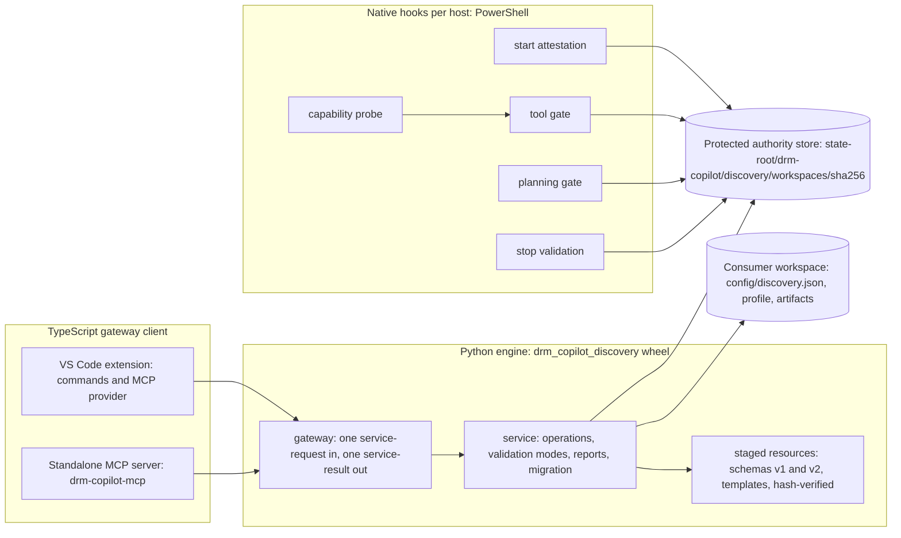

# Architecture

The capability is one Python engine, one TypeScript gateway client with two hosts, and a set
of native PowerShell hooks per agent host, all sharing one protected authority store outside
the consumer workspace. No component duplicates another's semantics: the engine owns artifact
meaning, the gateway client owns transport and receipt writing, and the hooks verify
protected authority without ever running Python.

## Components

### Python engine

The wheel `drm_copilot_discovery-2.0.0-py3-none-any.whl` (package
`packages/discovery-runtime`, import name `drm_copilot_discovery`) is the authoritative
implementation. It is installed into a trusted interpreter chosen by the consumer and
depends only on PyYAML, jsonschema, referencing and lxml. It contains:

- the service (`service.py` and the `service_*` modules), which executes the thirty fixed
  operations listed in [`cli-reference.md`](cli-reference.md) over captured, hash-pinned
  inputs and never over live caller-selected code;
- validation (`validation.py`, `validation_operation.py`, `schema_validation.py`) in the
  five modes `structural`, `agent-output`, `discovery-complete`, `parity-complete` and
  `planning`;
- the analyzers (`analyzer/`), described in [`analyzers.md`](analyzers.md);
- reports and acceptance generation (`coverage_report.py`, `parity_report.py`,
  `completion_report.py`, `acceptance_generation.py`, `gherkin.py`);
- initialization, configuration and the protected activation store (`init_flow.py`,
  `configuration.py`, `activation_store.py`, `activation_filesystem.py`);
- migration and transport (`migration_v1.py`, `snapshot.py`, `source_snapshots.py`,
  `transport_manifest.py`), described in [`migration.md`](migration.md);
- the staged resources under `_resources/` (seven frozen version 1 schemas, twenty-six
  version 2 schemas, six version 2 templates) with a SHA-256 manifest the runtime verifies
  before reading any resource, and `_build_manifest.json`, which records the digest of every
  installed file so an installation can prove its identity.

The engine exposes thirty-one `dev.discovery.*` console scripts and the gateway module
`drm_copilot_discovery.gateway`.

### TypeScript gateway client

`extensions/drm-copilot/src/discovery-runtime.ts` launches
`python -I -m drm_copilot_discovery.gateway --workspace-root <absolute> --principal
<principal>` without a shell, writes exactly one canonical JSON `service-request` to stdin
and validates the single JSON `service-result` on stdout. No module, program or code string
chosen by a caller is executed and no stdout sentence is parsed. When the module is missing
the client names the wheel file explicitly so the operator can install it.

Two hosts embed the same client and the same tool set
(`extensions/drm-copilot/src/mcp-server.ts` is the shared entry):

- the VS Code extension, which registers the `drmCopilotMcpProvider` MCP server definition
  and thirteen `drmCopilotExtension.*Discovery*` commands;
- the standalone MCP server `@danmoisan/drm-copilot-mcp` (package `packages/mcp-server`),
  which bundles the same entry with the VS Code module shimmed out and ships the native
  customization resources.

The gateway client is the only writer of protected validation receipts
(`validation-receipt`, `writer.kind = host-gateway`, `writer.component = extension |
standalone-mcp`).

### Native hooks

Each agent host runs the same decision logic from the shared PowerShell helpers under
`.claude/lib/discovery-validation` (published to the Codex bundle as `.codex/lib`):

| Control | Claude Code (`.claude/hooks`) | Codex (`.codex/hooks`) | GitHub Copilot (`.github/hooks`) |
|---|---|---|---|
| Start attestation | `record-discovery-agent-start.ps1` (SubagentStart) | `discovery-start-attestation.ps1` (dot-sourced by the routing attestation hook) | `discovery-agent-start.ps1` |
| Tool gate | `enforce-discovery-artifact-gate.ps1` (PreToolUse) | `enforce-discovery-artifact-gate.ps1` | `discovery-pre-tool.ps1` |
| Planning gate | `enforce-discovery-planning-gate.ps1` (PreToolUse, Agent) | `enforce-discovery-planning-gate.ps1` | `discovery-planning.ps1` |
| Stop validation | `validate-discovery-artifact-gate.ps1` (SubagentStop) | `validate-discovery-agent-output.ps1` | `discovery-agent-stop.ps1` |
| Capability probe | `discovery-capability-probe.ps1` | `discovery-capability-probe.ps1` | `discovery-capability-probe.ps1` |

The hooks read protected records and verify hashes; they invoke no Python and parse no
artifact. [`enforcement.md`](enforcement.md) describes each control.

### Protected authority store

Activation, invocations, receipts, authorizations and attestations live outside every
workspace at the platform state root: `LocalApplicationData` on Windows,
`~/Library/Application Support` on macOS, `$XDG_STATE_HOME` or `~/.local/state` on Linux,
under `drm-copilot/discovery/workspaces/<sha256 of the canonical workspace path>/`. The
workspace carries only a four-key locator at `config/discovery.json` (`schema_version`,
`enabled`, `profile_path`, `required_runtime_major`) and the profile it points at. Deleting
or editing the locator never disables an active protected activation; only a root-owned
`configure --deactivate` does.

## Host flows

The profile's `system.role` and `runtime.capability` select how the capability is used:

- **No runtime** (`runtime.capability: none`): source discovery only. Inventory, contracts,
  coverage and unspecified-behavior records are produced; runtime characterization
  scenarios stay `not-run` and the completion report records that no runtime evidence is
  required.
- **Manual** (`manual`): runtime scenarios are planned by the engine and executed by people;
  observations and evidence are recorded through `update-artifact` and `link-evidence`.
- **Semi-automated and automated** (`semi-automated`, `automated`): the same artifacts, with
  runs captured by the consumer's own tooling and linked as evidence; the engine never
  executes a consumer's application.
- **Combined** (`system.role: combined`): one repository is both legacy source and
  modernization target; the parity matrix's source and target repositories are the same
  identity.
- **Separate** (`legacy-source` plus a related `modernization-target` repository, or the
  reverse): each repository holds its own profile; source artifacts travel through
  `snapshot-export` and `snapshot-import` and the target records implementation through
  `implementation-record` artifacts.
- **Multi-client** (`clients`, `required_platforms`, `required_modes`): every feature
  contract is assessed per client, platform and mode, and acceptance specifications are
  generated per `client_id`, `platform_id` and `mode_id`.

## Principals and modes

Every service request names a principal: `local-user` for a human or root agent acting
through the CLI, extension or MCP server, and `host` for a gateway acting for a started
discovery agent. Root-only operations (`init`, `configure`, `snapshot-*`, `import-inventory`,
`migrate`, `prepare-agent`) are rejected for a discovery agent. Validation modes map to
receipts: a `native-root` identity may hold `structural`, `discovery-complete`,
`parity-complete` or `planning` receipts; a `discovery-agent` identity holds only
`agent-output` receipts, which the stop validation consumes.
