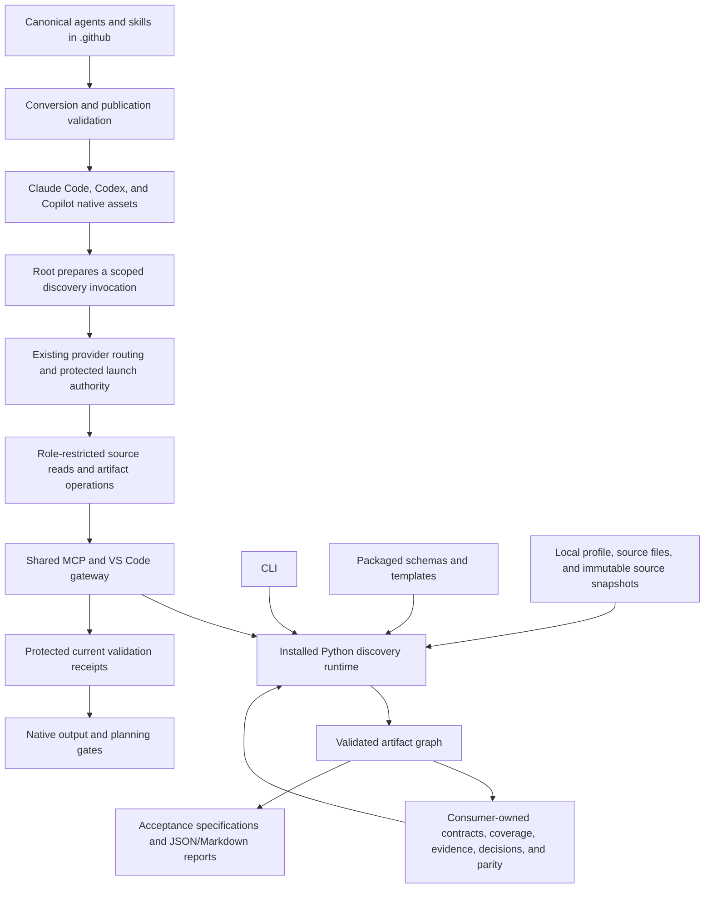

# 2026-10-17-legacy-discovery-and-parity — Spec

- **Issue:** #980
- **Parent (optional):** none
- **Owner:** drmoisan
- **Last Updated:** 2026-10-17T22-38
- **Status:** Draft
- **Version:** 0.1

## Overview

Repositories modernizing existing applications need a repeatable way to discover observable behavior, inventory features and workflows, characterize runtime behavior, track implementation inspection, and define source-to-target parity. Undocumented, contradictory, inferred, and intentionally unspecified behavior must remain explicit rather than becoming invented target requirements.

Develop a reusable, domain-neutral `legacy-discovery-and-parity` capability in `drm-copilot`. The framework supplies workflow mechanics, schemas, agents, skills, validators, hooks, templates, analyzers, CLI commands, MCP tools, publishing support, and documentation. Structured artifacts are authoritative; Markdown reports are generated views where practical. Observed facts, inferred behavior, product decisions, target requirements, and implementation status remain separate.

Consumer-specific names and follow-on work are confined to the separated case study and handoff below. This feature neither inspects nor modifies consuming repositories.

The supplied research is sufficient to complete this specification. The [core research](research/2026-10-18T02-40-core-contracts-and-analyzers-research.md) and [runtime research](research/2026-10-18T02-40-runtime-publishing-research.md) document actual implementation and primary external references. Existing commands, schemas, analyzers, and Claude assets are foundations to complete and harden; their presence does not establish the requested behavior. All normative decisions below describe the required final implementation, not functionality already verified.


## Behavior

Treat this as one large, cross-cutting feature. Follow the standard lifecycle: promote/create an active feature folder; perform repository and external research; author a detailed specification; produce an atomic implementation plan; delegate task-by-task implementation to appropriate specialists; run applicable language and repository quality gates; perform feature review; and produce complete evidence and handoff documentation. Persist orchestration state after every material phase and task transition. Do not implement in the orchestrator or modify canonical policy files outside established authoring and push-down mechanisms.

**1. Generic agent roles**

- Legacy Parity Analyst: systematically inspect a legacy repository, identify observable features/workflows, extract behavior without implementation proposals, classify verified/inferred/contradictory/unknown/intentionally unspecified behavior, maintain source/test/documentation/runtime traceability, and update contracts/coverage. It must neither make product decisions nor change production source.
- Runtime Characterization Analyst: define repeatable fixtures, preconditions, actions, observations, pre/post-state captures, runtime evidence, confidence, and environment dependencies. Support manual, semi-automated, and automated characterization without inventing unknown expected results.
- Requirements Reconciler: compare legacy contracts with target implementation records, maintain evidence-backed parity, classify missing/partial/conflicting/intentionally changed/retired behavior, and preserve observed-versus-approved behavior separation.
- Migration Coverage Reviewer: verify discovery completeness, component inspection/disposition, required-feature evidence/scenarios, and representation of unknown behavior in unresolved-behavior or product-decision records. Fail closed on incomplete required discovery.
- Apply repository model routing, tool allowlists, memory scope, hooks, output validation, and a SubagentStop validator to every new agent.

**2. Generic skills**

Provide `inventory-legacy-system`, `extract-feature-contract`, `characterize-runtime-behavior`, `reconcile-parity-matrix`, `review-discovery-coverage`, `adjudicate-unspecified-behavior`, `generate-acceptance-scenarios`, `initialize-discovery-workspace`, and `validate-discovery-artifacts`. Each declares explicit inputs, exact permitted output locations or configured roots, fail-closed missing-configuration behavior, deterministic artifacts where practical, and specialist routing. Publish through existing Claude Code, Codex, and GitHub Copilot mechanisms without domain assumptions.

**3. Repository-local configuration contract**

Define and justify a conventional profile path, provisionally `docs/migration/discovery/domain-profile.yaml`. Support system name/role (legacy source or modernization target), production/test/documentation/evidence roots, solution/project entry points, required platforms/modes, domain extensions, analyzer settings, excluded paths, output roots, source/target repository references, required feature dimensions, and completion gates. Read configuration rather than hard-code consumer paths. Supply schema, validation, initialization template, separate example, and documentation.

**4. Versioned machine-readable schemas**

Prefer JSON Schema unless research establishes a stronger repository convention. Domain extensions must preserve all core validation. Provide:

- Feature Contract: schema version, feature ID/name/group/summary, trigger, preconditions, inputs, state transitions, observable outputs, side effects, ordering/timing, cancellation/failure/offline behavior, mobile/alternate-client applicability, environment constraints, security/permissions, source/runtime evidence, confidence, unresolved questions, product-decision status, target relevance, and domain metadata.
- Coverage Ledger: repository revision, discovered components/types, paths/symbols, inspection status, disposition, linked contracts/tests, runtime-validation requirement, exclusions/rationale, responsible workflow/agent, and last-updated evidence.
- Runtime Characterization Scenario: scenario ID, feature links, environment, fixture, preconditions, action, observation plan, pre/post-state captures, expected result when known, result status, deviations, evidence, repeatability, confidence, and unresolved findings.
- Parity Matrix: source/target repositories and pinned revisions, feature ID, source contract, target implementation, overall/dimension-specific parity, offline/mobile status, evidence, intentional deviations, retirement decision, blockers, and validation status.
- Unspecified Behavior Record: behavior ID, feature link, question, evidence, competing interpretations, impact, status, decision owner, decision/rationale, approved target behavior, and acceptance-test implications.
- Product Decision Record: decision ID, linked features/unspecified behaviors, decision/rationale/alternatives, affected platforms, required migration behavior, approval metadata, and resulting acceptance criteria.
- Reusable Evidence Reference: type, repository/revision, path/symbol/line range, runtime artifact, timestamp, environment, checksum where applicable, author/agent, confidence, and notes.

**5. Deterministic validators**

Provide equivalents of `dev.discovery.validate-profile`, `validate-feature-contract`, `validate-coverage-ledger`, `validate-runtime-scenario`, `validate-parity-matrix`, `validate-decisions`, and `validate-all`. Detect malformed artifacts, unsupported versions, duplicate IDs, broken references, missing evidence, invalid statuses/confidence, unresolved behavior marked verified, parity without source contracts, required-parity features without acceptance scenarios, missing platform classifications, coverage without disposition, exclusion without rationale, conflicting decisions, and deterministically detectable stale revisions. Complete validation emits Markdown and JSON and exits nonzero on blocking failures.

**6. Configurable completion gates and hooks**

Prevent research agents from modifying production code. Require evidence for verified contracts, runtime evidence for passed runtime scenarios, and unspecified-behavior records for unknown/contradictory behavior. Require all in-scope component dispositions and acceptance scenarios for required features. Require online/offline/mobile classifications only for dimensions declared required by the profile. Gate implementation planning when configured discovery completion remains incomplete. Malformed configuration fails closed; each new agent has SubagentStop output validation.

**7. Initialization and templates**

Provide `dev.discovery.init` or a convention-aligned equivalent. Initialization is idempotent, supports dry-run, never silently overwrites content, reports created/skipped/conflicting files, and validates the resulting workspace. Production templates contain no domain-specific sample values. A proposed structure is:

```text
docs/migration/discovery/
  domain-profile.yaml
  scope.yaml
  coverage-ledger.json
  unspecified-behaviors.yaml
  product-decisions.yaml
  feature-contracts/
  characterization/
  evidence/
  reports/
```

Research may justify a different conventional structure. Keep documented synthetic fixtures separate from production templates.

**8. Generic static analyzers**

Implement at least repository/project inventory and one meaningful C#/.NET analyzer. Evaluate and implement where practical: tree/project inventory; .NET solutions/projects; C# types/symbols; event subscriptions; configuration/settings; file-system and registry access; COM interop; UI callbacks; test-to-production reference mapping; dependencies. Outputs are deterministic, machine-readable, source-referenced, read-only/dry-run capable, usable by coverage workflows, and explicit about detected facts versus inferred interpretations. Support local plugin/enrichment configuration.

Evaluate a reusable Office/VSTO analyzer that recognizes generic Ribbon XML/callbacks, interop references, `ThisAddIn`, COM events, item types, and MAPI access without product semantics. This is an optional analyzer evaluation, not permission to add Office-specific behavior to the core. Evaluate existing dependencies and simpler parsing before adding Roslyn or other heavy parsing dependencies.

**9. CLI, extension, and MCP integration**

Python is authoritative. Use a coherent convention-aligned namespace equivalent to `dev.discovery.init`, `inventory`, `new-contract`, `new-scenario`, `link-evidence`, `validate`, `coverage-report`, `parity-report`, and `generate-acceptance`. Expose individual validators and complete validation. VS Code and standalone MCP provide appropriate thin workspace-facing wrappers. Require validated workspace-relative paths, actionable errors, deterministic outputs, noninteractive agent invocation, and Python/wrapper tests.

**10. Cross-ecosystem publishing**

Use the existing canonical-source, generation, conversion, validation, and push-down architecture for agents, skills, rules, prompts, hooks, templates, and documentation. Publish to Claude Code, Codex, and GitHub Copilot. Do not manually maintain divergent implementations. Prove representation and absence of unsupported generated references with publishing/conversion tests.

**11. Acceptance-scenario generation**

Generate Gherkin-style Markdown or `.feature` specifications from confirmed contracts and product decisions. Preserve feature/scenario IDs, platform/mode/offline/mobile tags where applicable, evidence and decision traceability, and pending unresolved behavior. Distinguish legacy characterization, target acceptance, and implementation-specific automated tests. Generate test specifications rather than implementation-specific test code unless a later local implementation workflow explicitly requests it.

**12. Deterministic reports**

- Discovery Coverage: total, inspected, excluded, blocked, undispositioned components; feature-contract/runtime-characterization coverage; evidence completeness; unresolved behavior count.
- Parity: total/full/partial/missing/intentionally changed/retired features; online/offline/mobile verification; blockers; unresolved decisions.
- Discovery Completion: pass/fail, blocking findings, warnings, stale/conflicting references, incomplete artifacts, and next actions.
- Emit Markdown and JSON for each report.

**13. Documentation**

Document architecture, ownership boundaries, installation/push-down, initialization, profiles, artifact lifecycle, agent responsibilities, workflow examples, validators, hooks, schema extensions, evidence rules, and the source/target model. Provide architecture diagram, example consuming-repository structure, setup guide, status semantics, and maintainer guidance. Any TaskMaster/TMW example is clearly separated and noncanonical.

**14. Testing**

Cover schemas, valid/invalid fixtures, references, duplicate IDs, initialization idempotency/dry-run/conflicts, reports, analyzers, hooks, agent outputs, CLI, MCP, justified extension commands, conversion/push-down, path safety, malformed configuration, Windows, and applicable cross-platform behavior. Use synthetic fixtures; a deliberately added small licensed example requires explicit documentation. Follow repository isolation, coverage, file-size, and complete quality-gate requirements.

**15. Non-goals**

Do not implement consumer feature contracts, inspect/modify TaskMaster or TMW, encode Outlook product requirements, define consumer target architecture, build a full Outlook UI test framework, add domain-specific feature IDs, store migration evidence/catalogs authoritatively in this repository, duplicate orchestration logic, maintain divergent ecosystem implementations, or weaken fail-closed quality/security policies.

**Ownership and supported deployment shapes**

`drm-copilot` owns reusable agents, skills, standing rules, schemas, validators, hooks, templates, analyzers, initialization, commands, MCP/VS Code wrappers, publishing, and framework documentation. A legacy repository owns its profile/scope/contracts/coverage/runtime characterization/evidence/unspecified behavior/legacy architecture and local characterization tools. A target repository owns architecture decisions, implementation records, authoritative parity, acceptance/offline/mobile tests, implementation evidence, and target tools.

Support one repository containing source and target; separate source/target repositories; no runtime characterization capability; manual or automated runtime evidence; optional offline/mobile dimensions; and multiple target clients. Prefer thin composable modules, deterministic local analysis, no external-service requirement for validation/reports, and context loaded only on relevant workflow invocation.

**Required research before implementation**

Investigate using actual repository evidence and external primary sources:

1. Authoring/publishing of current agents, skills, hooks, schemas, CLI, MCP, and VS Code commands.
2. The canonical customization surface.
3. Conversion handling for agents, skills, rules, hooks, and templates.
4. Feature-folder and evidence-location conventions.
5. Hook context and configuration transport.
6. Existing JSON Schema infrastructure.
7. Existing YAML parsing/validation dependencies.
8. MCP creation/validation/reporting/analyzer invocation patterns.
9. Existing output validators.
10. Existing reusable skills to avoid duplication.
11. Atomic-planning/acceptance-tracking integration for discovered criteria.
12. Backward compatibility for repositories not using discovery.
13. Schema versioning and future artifact migration.
14. Determinism across Windows, Linux, and macOS.
15. Roslyn/compiler-backed C# analysis versus simpler parsing and existing dependencies.
16. Avoidance of unnecessary context injection for nonparticipants.

**Required specification decisions**

Decide final capability name; canonical locations; agent names/responsibilities; skill names/inputs; schema format/versioning; status/confidence enumerations; extensions; local configuration; evidence format; validation/hooks/analyzers architecture; CLI naming; MCP/VS Code exposure; publishing; backward compatibility; future schema migration; completion defaults; optional-dimension activation; scenario generation; discovery versus implementation acceptance-criteria check-off; and immutable source-revision references in target parity.

**Required deliverables**

1. Active feature documentation.
2. Repository and external research artifact.
3. Detailed specification.
4. Atomic implementation plan.
5. New/updated agents.
6. New/updated skills.
7. Versioned schemas.
8. Deterministic validators.
9. Configurable hooks.
10. Generic templates.
11. CLI tooling.
12. Generic analyzers.
13. MCP integration.
14. VS Code integration where justified.
15. Cross-ecosystem publication support.
16. Comprehensive tests.
17. User and maintainer documentation.
18. Discovery architecture diagram.
19. Example consuming-repository structure.
20. Final feature audit.
21. Completion report with acceptance-criteria status.
22. Follow-on handoff describing exact local TaskMaster and TMW work after publishing.


## Inputs / Outputs

### Final names, ownership, and canonical locations

The capability name remains `legacy-discovery-and-parity`; the public command prefix remains `dev.discovery`. This matches the existing engineering documentation and registered Python commands. Extend the existing implementation and retain safe compatibility adapters; do not introduce another discovery engine or orchestration lifecycle.

| Content | Canonical authoring location | Installed or consumer location |
| --- | --- | --- |
| Authoritative Python implementation | `packages/discovery-runtime/src/drm_copilot_discovery/` after moving reusable discovery implementation once | Distribution `drm-copilot-discovery`, import package `drm_copilot_discovery` |
| Existing Python imports/entry points | `scripts/dev_tools/discovery/` and existing adjacent entry modules become thin compatibility adapters | New wheel exposes the same console-script names; no root-repository dependency |
| Artifact schemas | `schemas/discovery/v1/` retained unchanged; new `schemas/discovery/v2/` | Generated package resources loaded through `importlib.resources` |
| Production templates | `docs/discovery/templates/v2/` | Generated package resources; no sample feature claims or evidence |
| Valid synthetic examples | `examples/discovery/v2/` | Documentation/test inputs only, separate from production templates |
| Agent bodies and workflows | `.github/agents/<role>.agent.md`, `.github/skills/<skill>/SKILL.md` | Existing Copilot, Claude, and Codex publication surfaces |
| Native enforcement adapters | Existing host settings, `.claude/hooks/`, `.codex/hooks/`, and new published `.github/hooks/` support | Native host-specific event registration; shared rule/receipt contracts |
| Framework documentation | `docs/engineering/legacy-discovery-and-parity/` | Published setup and reference documentation; links remain valid after installation |
| Default local artifacts | `docs/migration/discovery/` in each consumer | Profile-selected workspace-relative roots; never stored as consumer catalogs in this repository |
| Local activation locator | `config/discovery.json` in a participating consumer | Versioned declaration identifying the single profile; root/configuration operations own it |
| Ordinary orchestration | Existing `artifacts/orchestration/orchestrator-state.json` | Unchanged feature lifecycle checkpoint |
| Standalone discovery invocation mirror | `artifacts/orchestration/discovery-invocations/<invocation-id>.json` | Non-evidence invocation/receipt mirror; protected authority is outside the workspace |

Schema and template resources are generated from the listed canonical locations into the wheel build tree. Generated resources and ecosystem outputs must be reproducible and verified against source hashes; they are not independently authored copies. New files in this specification are proposed implementation targets, not assertions that those files currently exist.

### Profile and activation contract

The new profile has `profile_version: 2`, `schema_version: "2.0.0"`, and `artifact_kind: domain-profile`. JSON Schema Draft 2020-12 is authoritative for JSON and YAML representations. The exact supported versions are catalog entries, not a permissive major-version regular expression. YAML uses a discovery-specific SafeLoader with duplicate-key, merge-key, alias-cycle, non-string-key, nonfinite-number, and non-JSON-type rejection. JSON has the equivalent duplicate-key and nonfinite-number checks. Limits are 16 MiB per structured document, nesting depth 64, 100,000 artifact records, and 1,000,000 enumerated source files; bounded larger limits may be explicitly configured by the root, never removed by analyst inputs.

Required top-level profile fields and their semantics:

| Field | Required structure and decision |
| --- | --- |
| `system` | `{id, name, role}`; role is `legacy-source`, `modernization-target`, or `combined`; names supplied by the consumer |
| `repository` | Stable `{id, vcs: git, revision, revision_policy}`; revision is a full 40- or 64-hex commit or null in a draft profile; policy is `pinned` or `working-tree-at-pin` |
| `profile_state` | `draft` or `configured`; draft is structurally valid, never sufficient for completion |
| `production_roots`, `test_roots`, `project_entry_points`, `documentation_roots` | Explicit lists of workspace-relative paths; production list is nonempty before completion; missing optional directories are classified, not silently scanned elsewhere |
| `evidence_roots` | Readable local evidence roots and the controlled evidence-record/payload output root; external references use repository identities and imported manifests, not sibling filesystem access |
| `repositories` | Related source/target records `{id, role, revision, snapshot_manifest, clients}`; source and target pins remain separate even in a combined repository |
| `clients` | Stable client IDs, target repository ID, platform IDs, supported operating modes, required feature dimensions, and applicability defaults |
| `required_platforms`, `required_modes`, `required_feature_dimensions` | Explicit arrays; default required mode is `online`; offline/mobile are never implicitly required |
| `runtime` | `{capability: none|manual|semi-automated|automated, required_feature_ids}`; no-capability repositories still record evidence/unknowns honestly |
| `analyzers` | Ordered-independent enabled built-in analyzer IDs, bounded options, ignored-path rules, and approved extension-result manifest paths; no executable/module names from profile values |
| `excluded_paths` | Entries `{path_or_glob, rationale}`; nonempty rationale required; exclusions are part of the inventory input digest |
| `artifacts` | Exact output roots in the next table plus one profile/scope/ledger/decision/parity file each; no inference from current working directory |
| `completion_gates` | Literal booleans/enums for the gate settings below; wrong types and unknown keys fail closed |
| `decision_owners` | IDs allowed to approve decisions, with approval evidence requirements; analysts cannot grant themselves this role |
| `extensions` | Namespaced JSON payloads only; namespace pattern `^[a-z][a-z0-9]*(?:[.-][a-z0-9]+)+$` |
| `extension_schemas` | Optional namespace-to-local-schema mappings under configured documentation roots, with declared SHA-256; a restricted extension-schema catalog cannot replace core schemas or fetch remote resources |

Output configuration has closed keys and defaults:

| Key | Default workspace-relative path | Permitted content |
| --- | --- | --- |
| `root` | `docs/migration/discovery` | Parent declaration only; not a blanket write grant |
| `scope` | `docs/migration/discovery/scope.yaml` | Confirmed/draft discovery scope and inventory selection |
| `coverage_ledger` | `docs/migration/discovery/coverage-ledger.json` | Component inspection/disposition records |
| `unspecified_behaviors` | `docs/migration/discovery/unspecified-behaviors.yaml` | Versioned unresolved-behavior collection |
| `product_decisions` | `docs/migration/discovery/product-decisions.yaml` | Versioned proposed/approved/rejected decision collection |
| `parity_matrix` | `docs/migration/discovery/parity-matrix.json` | Target/combined parity collection |
| `feature_contracts` | `docs/migration/discovery/feature-contracts` | One contract document per feature ID |
| `characterization` | `docs/migration/discovery/characterization` | Runtime characterization scenario documents |
| `evidence` | `docs/migration/discovery/evidence` | Evidence-reference documents and referenced payloads |
| `inventory` | `docs/migration/discovery/inventory` | Analyzer snapshots and diagnostics |
| `acceptance` | `docs/migration/discovery/acceptance` | Structured specifications plus generated Markdown/Gherkin |
| `reports` | `docs/migration/discovery/reports` | Deterministic JSON/Markdown views and role-output manifests |
| `source_snapshots` | `docs/migration/discovery/source-snapshots` | Imported immutable source manifest/contracts/evidence references |
| `implementation_records` | `docs/migration/discovery/implementation-records` | Target-owned references to implementation and verification tests |

Roots may be customized explicitly, but must remain within the workspace and be disjoint from production/test inputs, native configuration, framework code, schema/policy files, and authority storage. Nested roots are permitted only for the documented parent/child artifact hierarchy. Writable evidence is never executable authority. Reserved output names, path collisions, case aliases, and symlink/reparse escapes are blocking configuration errors.

`config/discovery.json` contains only `{schema_version: "2.0.0", enabled: true, profile_path, required_runtime_major: 2}`. It does not contain success or permission claims. Initialization/configuration also records activation in the protected per-workspace registry. An existing default profile without a locator is detected and requires explicit activation before controlled agents start; explicit validators can report the required activation action. Multiple candidate profiles or a locator/argument disagreement fail. Deleting or disabling the locator/profile while the protected registry says active blocks discovery and configured planning gates. Only a root-owned `deactivate` operation can deliberately remove activation; it records the action and invalidates outstanding grants/receipts. Unrelated repositories with no activation and no default profile remain unaffected.

Completion defaults are `require_confirmed_scope=true`, `require_current_inventory=true`, `require_all_dispositions=true`, `require_feature_evidence=true`, `require_acceptance_scenarios=true`, `require_runtime_for_declared_features=true`, `block_on_unresolved_required_behavior=true`, `require_approved_deviations=true`, and `planning_prerequisite=discovery-complete`. `planning_prerequisite` may be `none`, `discovery-complete`, or `parity-complete` through explicit root configuration. Core claim consistency, evidence for verified/passed claims, exclusion rationale, profile validity, and path safety cannot be disabled. Optional dimensions become obligations through the union of global requirements, client requirements, and feature-specific requirements; a feature cannot weaken its parent's required dimensions.

### Artifact catalog and status model

Every v2 structured document requires `$schema`, `schema_version: "2.0.0"`, `artifact_kind`, and a stable `id`; collections additionally use a closed `records`, `components`, or `entries` field selected by their exact schema. IDs match `^[a-z][a-z0-9]*(?:[._-][a-z0-9]+)*$`, are case-sensitive, and are unique within the repository/kind namespace; references always identify their kind. Bare ambiguous cross-repository IDs are invalid. Expected kind comes from the command/configured root, never from an artifact-selected schema.

Schema IDs use `urn:drm-copilot:discovery:2.0.0:<artifact-kind>`. The trusted offline registry contains exactly the supported v1 aliases and v2 IDs. Unknown versions, mismatched `$schema`, external retrieval, unavailable full `jsonschema`/`referencing` support, and schema fallback are blocking. Validate formats explicitly. All core objects reject additional properties; domain payloads live only under `extensions` and must pass both core and any configured extension schema. Domain schemas cannot redefine IDs, statuses, references, dimensions, evidence, or gates.

| Axis | Enumerated values | Meaning |
| --- | --- | --- |
| Feature lifecycle | `draft`, `reviewed`, `superseded` | Authoring state, never parity or approval |
| Observed behavior state | `verified`, `inferred`, `unknown`, `contradictory`, `intentionally-unspecified` | What the legacy evidence establishes |
| Confidence | `high`, `medium`, `low`, `unknown` | Confidence in a specific recorded observation or inference |
| Product decision state | `not-required`, `proposed`, `approved`, `rejected`, `superseded` | Independent target-policy approval state |
| Target relevance | `required`, `optional`, `retired`, `undecided` | Migration disposition; retired requires approved decision |
| Inspection | `uninspected`, `inspected`, `blocked` | Whether the component has been inspected |
| Coverage disposition | `unassigned`, `feature-linked`, `supporting`, `excluded`, `blocked` | Why the component is accounted for; unassigned/blocked prevent completion |
| Runtime result | `not-run`, `observed`, `passed`, `failed`, `blocked`, `not-applicable` | Observation is distinct from comparison against a known expectation |
| Repeatability | `not-assessed`, `repeatable`, `variable`, `environment-dependent` | Backed by recorded runs/environment |
| Parity | `unassessed`, `full`, `partial`, `missing`, `conflicting`, `intentionally-changed`, `retired` | Target relationship to a pinned source contract |
| Dimension applicability | `applicable`, `not-applicable`, `unspecified` | A required dimension cannot remain unspecified; not-applicable requires rationale/approved disposition |
| Dimension verification | `not-run`, `passed`, `failed`, `blocked`, `not-applicable` | Evidence-backed target verification independent from applicability |
| Unspecified behavior | `open`, `under-review`, `resolved`, `intentionally-unspecified` | Resolution must reference an approved decision or verified observation |
| Acceptance readiness | `ready`, `pending`, `superseded` | Executable specification readiness, never an automated-test pass |
| Validation outcome | `pass`, `fail` | Derived from findings for an explicit validation mode |

All required feature dimensions use a common `behavior-dimension` object: `{observation_state, statement, evidence_refs, unresolved_behavior_refs, confidence}`. Unknown/contradictory fields carry no invented statement and link an unresolved record. Intentionally unspecified fields identify an approved decision and its rationale. Optional not-applicable classifications retain a rationale. A contract-wide summary cannot conceal an unresolved required dimension.

| Artifact/schema | Required fields and conditional constraints |
| --- | --- |
| `feature-contract` | `feature_id`, `name`, `capability_group`, `summary`, `lifecycle`, `observation_state`, `trigger`, `preconditions`, `inputs`, `state_transitions`, `observable_outputs`, `side_effects`, `ordering`, `timing`, `cancellation`, `failure`, `offline`, `mobile`, `alternate_clients`, `environment_constraints`, `security_permissions`, `source_evidence_refs`, `runtime_evidence_refs`, `confidence`, `unresolved_behavior_refs`, `product_decision_status`, `product_decision_refs`, `target_relevance`, `required_dimensions`, `acceptance_criteria`, `extensions`. Each acceptance criterion has stable criterion ID, statement/known expectation or pending reason, evidence/decision links, and client/mode applicability. Transitions carry before/action/after observations and evidence. Arrays may be empty only where the field explicitly records none/not-applicable/unknown. |
| `coverage-ledger` | `repository`, pinned `revision`, `inventory_snapshot_refs`, `scope_ref`, `components`, `extensions`. Each component has `component_id`, `component_type`, `path`, optional `symbol`/inclusive line range, `inspection_status`, `disposition`, `feature_refs`, `tests_found`, `runtime_validation_requirement`, `exclusion_rationale`, `responsible_workflow`, `responsible_agent`, and `last_updated_evidence_refs`. Supporting components need rationale; exclusions need rationale and scope linkage. Summaries are derived, never authority. |
| `runtime-characterization-scenario` | `scenario_id`, `feature_refs`, `environment`, `fixture`, `preconditions`, `action`, `observation_plan`, `pre_state_capture`, `post_state_capture`, nullable `expected_result`, `expected_result_basis`, `result_status`, `deviations`, `evidence_refs`, `repeatability`, `confidence`, `unresolved_findings`, `runs`, `extensions`. Capture fields declare plans before execution and evidence references after execution. `passed` requires a known expectation plus runtime evidence; a first observation with no expectation is `observed`, never `passed`. |
| `parity-matrix` | `source_repositories`, `target_repositories`, `entries`, `extensions`. Each entry identifies `feature_id`, immutable `source_contract_ref`, `client_id`, pinned `target_repository`, `target_implementation_refs`, `parity_state`, `dimensions`, explicit `online`/`offline`/`mobile` classifications as configured, `evidence_refs`, `intentional_deviation_refs`, nullable `retirement_decision_ref`, `blockers`, and `validation_status`. A target implementation reference includes repository/revision/path/symbol/test/evidence links; missing behavior can have an empty implementation list with reason. |
| `unspecified-behavior` | `behavior_id`, `feature_refs`, `question`, `evidence_refs`, `competing_interpretations`, `impact`, `status`, nullable `decision_owner`, nullable `decision_ref`, nullable `decision`, nullable `rationale`, nullable `approved_target_behavior`, `acceptance_test_implications`, `extensions`. Resolution cannot silently replace observed facts. |
| `product-decision` | `decision_id`, `feature_refs`, `unspecified_behavior_refs`, `decision_key`, `scope` (feature/client/platform/mode/dimension), `status`, `decision`, `rationale`, `alternatives`, `affected_platforms`, `required_migration_behavior`, `approval` (owner, timestamp, evidence references), `resulting_acceptance_criteria`, `supersedes`, `extensions`. Only approved records establish target requirements; proposals remain pending. |
| `evidence-reference` | `evidence_id`, `evidence_type`, `repository`, `revision`, `path`, optional `symbol` and one-based inclusive `line_range`, nullable `runtime_artifact`, `timestamp`, `environment`, `checksum`, `author_or_agent`, `confidence`, `notes`, `extensions`. Evidence types: `source`, `test`, `documentation`, `runtime`, `observation`, `decision`, `inventory`. Runtime/manual capture identifies the environment and capture method. Source/test references pin full revisions; local payloads require SHA-256. URI-only evidence can be descriptive but cannot prove a completion claim without a locally verifiable capture. |
| `scope` | `status: draft|confirmed`, repository/pin, included roots/components/features, exclusions with rationale, inventory snapshot refs, confirmed-by metadata, required feature/client/mode coverage. An empty scope needs explicit justified no-scope disposition and cannot satisfy required migration features. |
| `inventory-snapshot` | Analyzer/tool versions, repository/pin, scan configuration digest, sorted inspected file paths and exact byte hashes, detected components, declared/inferred relationships, diagnostics, exclusions, capture metadata. Every input file inspected or excluded is accounted for. |
| `acceptance-specification` | Stable scenario ID, `kind: legacy-characterization|target-acceptance`, feature/criterion/client/mode IDs, readiness, Given/When/Then data where known, pending reasons, immutable contract refs, evidence/decision refs, tags, source content digest. Implementation test references are separate optional links, never generated source code. |
| `source-snapshot-manifest` | Source repository ID/full revision, exported contract/evidence paths and SHA-256 values, schema/tool versions, manifest digest, and verified transport metadata; imported bytes must match exactly. |
| `implementation-record` | Target repository/revision/client, feature refs, implementation paths/symbols, test references, verification evidence and state; contains no redefinition of the source contract. |
| Collection envelopes | Versioned `unspecified-behavior-collection` and `product-decision-collection` schemas with strict record schemas; individual commands accept their exact record kind and `validate-decisions` validates both collections and cross-links. |
| Runtime control schemas | Versioned activation, service request/result, discovery invocation, required-output manifest, validation receipt, and migration report contracts. Control schemas are published for interoperability but workspace-authored control documents cannot grant authority. |

### Initialization and external inputs

`init` requires system ID/name, role, repository identity, and explicit source roots (or an explicit draft configuration). It reads the local Git revision through a fixed read-only repository adapter when available; absent revision remains null/draft, never a fabricated pin. It creates an honest draft scope, empty ledger and unresolved/decision collections, target/combined parity collection, and the configured artifact directories. It creates no feature, accepted decision, runtime result, or successful completion report. Production templates use caller-provided values and empty structured collections; synthetic examples remain separate.

Initialization first calculates and validates a creation plan entirely in memory. `--dry-run` reports that plan and validates the projected structure without creating files, directories, activation records, or receipts. A normal run uses exclusive create operations, preserves existing valid files, classifies incompatible existing content as conflicts, and revalidates the resulting structure. A conflict aborts before writes; a concurrent collision aborts the remaining writes and reports exact partial creations without overwriting anything. Re-running after any partial creation is safe. Existing `--force` is retained only as a deprecated compatibility flag and cannot overwrite; a request that depends on old overwrite behavior fails with a migration instruction.

No environment variable can choose a validator module, arbitrary command, authority writer, or output path. Host configuration selects a trusted Python interpreter; core commands accept explicit workspace/configuration data. Read-only inspection may consume source, tests, manifests, and docs; local artifact/evidence roots remain the only mutation targets for discovery workflows. No network is required for validation, reporting, inventory, or acceptance generation.

## API / CLI Surface

### Authoritative service and command conventions

The service entry point is `drm_copilot_discovery.service.execute(request, *, io, repository_reader, clock, analyzer_registry) -> DiscoveryResult`. Pure parsing/catalog/graph/report/generation functions accept immutable snapshots. I/O, Git reads, process invocation, and writes are adapters. Hosts call the fixed installed module entry `python -I -m drm_copilot_discovery.gateway`, sending one versioned JSON request on stdin; they do not interpolate shell command strings or permit caller-selected Python code. Installed-version/schema compatibility is checked before execution.

All public commands accept `--workspace-root <directory>`, optional `--profile <workspace-relative file>` resolved against activation/default rules, and `--format json|markdown|both` where a report is meaningful. Wrappers obtain the trusted workspace from their established workspace-explicit context; that outer root may be absolute, while every artifact/config/input/output path is workspace-relative. CLI omission of `--workspace-root` uses the current directory as the explicit invocation boundary, never an ancestor or neighboring repository search. Configuration changes and artifact mutations support `--dry-run`; read-only operations write only when `--write` or an explicit report destination is requested. The complete validation command writes its two canonical report files by default, with `--dry-run` returning both projected reports instead.

Exit codes: `0` for the selected operation/gate passing, `1` for blocking artifact/completion findings, `2` for invalid invocation/configuration/path/version, and `3` for runtime/dependency/I/O/authority failure. Partial writes never report success. Findings include stable `code`, `severity: error|warning|info`, `artifact_path`, JSON pointer, related IDs/paths, message, and actionable `next_action`; their ordering is path, pointer, code, related ID. Do not parse human sentences to discover result paths.

The JSON result is `{result_version: "2.0.0", operation, mode, ok, exit_code, findings, artifacts, summary, input_manifest, runtime}`. Artifact results include relative path, kind, status `planned|created|updated|skipped|conflict`, and content digest; `summary` is operation-specific. `runtime` identifies package/schema versions and build digest. A protected host receipt is returned only as an opaque reference; JSON result success is never itself gate authority. Malformed/truncated stdout, unsupported result versions, inconsistent exit codes, absent required fields, or a process failure become blocking wrapper errors.

### Command inventory

| Command | Operation-specific inputs and behavior |
| --- | --- |
| `dev.discovery.init` | `--system-id`, `--system-name`, `--role`, `--repository-id`, repeatable `--production-root`, optional `--test-root`, `--profile`, `--draft`, `--dry-run`; create/validate the projected no-overwrite structure |
| `dev.discovery.configure` | `--input <profile>`, `--activate` or explicit `--deactivate`, `--dry-run`; root-owned profile/locator changes, protected activation update, invalidate previous authority |
| `dev.discovery.profile` | Preserve the existing command as a normalized profile inspection/validation adapter |
| `dev.discovery.inventory` | Optional repeatable `--analyzer <registered-id>`, `--write`, `--dry-run`; seed a deterministic inventory and proposed coverage entries, never claim inspection/disposition automatically |
| `dev.discovery.dotnet`, `dev.discovery.vsto` | Preserve existing analyzer commands; select the corresponding registered adapter and require profile consent, especially for optional platform analysis |
| `dev.discovery.new-contract` | `--feature-id`, `--name`, optional capability group and supplied structured `--input`; create a structurally valid draft plus unresolved records for unknown required dimensions in one validated mutation |
| `dev.discovery.new-scenario` | `--scenario-id`, repeatable `--feature-id`, `--input`; create a draft observation plan with unknown expected result preserved |
| `dev.discovery.update-artifact` | `--kind`, `--path`, `--input`, `--expected-sha256`, `--dry-run`; controlled whole-document compare-and-swap replacement after prospective graph validation; no arbitrary text patch or output path |
| `dev.discovery.link-evidence` | `--artifact-kind`, `--artifact-id`, `--evidence <record>`, `--expected-sha256`, `--dry-run`; validate evidence and atomically link it to the requested entity |
| `dev.discovery.validate-profile` | Exact v1 compatibility or v2 profile validation; full graph gates require configured v2 |
| `dev.discovery.validate-feature-contract` | `--artifact <file>`; expected-kind structural/claim validation; resolve references in the configured snapshot |
| `dev.discovery.validate-coverage-ledger` | Ledger and configured scope/inventory/reference checks |
| `dev.discovery.validate-runtime-scenario` | Scenario/evidence/expected-result and linked-feature checks |
| `dev.discovery.validate-parity-matrix` | Matrix/source snapshots/target records/decision/dimension checks |
| `dev.discovery.validate-unspecified-behavior` | Preserve individual unresolved-record validation |
| `dev.discovery.validate-product-decision` | Preserve individual decision validation |
| `dev.discovery.validate-evidence-reference` | Preserve individual evidence-reference validation |
| `dev.discovery.validate-decisions` | Validate both decision/unresolved collections, scopes, approvals, supersession, and references |
| `dev.discovery.validate-all` | Entire configured workspace; `--mode structural|discovery-complete|parity-complete|planning`, optional root-authorized `--output-prefix`; default structural report is not completion |
| `dev.discovery.validate` | Alias to `validate-all`; reject legacy single-document type-probing ambiguity and direct callers to the individual validator |
| `dev.discovery.coverage-report` | Validated graph coverage report; Markdown/JSON; optional `--write` |
| `dev.discovery.parity-report` | Validated source/target/client parity report; Markdown/JSON; optional `--write` |
| `dev.discovery.completion-report` | Selected completion mode, findings and next actions; no unconditional ready state |
| `dev.discovery.generate-acceptance` | `--kind legacy-characterization|target-acceptance`, optional feature/client/mode filters, `--output-format markdown|gherkin|both`, `--dry-run`; structured source plus rendered views |
| `dev.discovery.generate-acceptance-scenarios` | Compatibility alias to the same generator; runtime characterization is not an unconditional input requirement |
| `dev.discovery.snapshot-export` | Export selected source contracts/evidence references with full repository revision and immutable content manifest; no external copy destination |
| `dev.discovery.snapshot-import` | `--manifest <local path>`, `--dry-run`; validate imported local bytes and identities, copy without overwrite into source-snapshot root; no network fetch or sibling-repository scan |
| `dev.discovery.import-inventory` | Validate an explicitly supplied local extension-result manifest; merge proposed coverage inventory without executing plugin names from configuration |
| `dev.discovery.migrate` | `--from-version 1`, `--to-version 2`, `--destination <new relative root>`, required local context as needed, `--dry-run`; no-overwrite conversion and unresolved-field report |
| `dev.discovery.doctor` | Inspect installed version/resources, profile/locator, fixed runtime path and supported host capability status; read-only and actionable |

Example invocations assume the installation has supplied these console scripts and the caller substitutes its own local context:

```text
dev.discovery.init --workspace-root . --system-id sample-system --system-name "Sample System" --role legacy-source --repository-id example/source --production-root src --draft --dry-run
dev.discovery.init --workspace-root . --system-id sample-system --system-name "Sample System" --role legacy-source --repository-id example/source --production-root src --draft
dev.discovery.inventory --workspace-root . --analyzer repository --analyzer dotnet --write
dev.discovery.validate-all --workspace-root . --mode structural
dev.discovery.validate-all --workspace-root . --mode discovery-complete
dev.discovery.generate-acceptance --workspace-root . --kind target-acceptance --output-format both --dry-run
```

After initialization, structural validation passes; discovery completion returns blocking findings for the draft profile/scope and incomplete coverage. The examples do not assert real source behavior or use consumer-specific features.

### MCP and VS Code surface

Extend existing `mcp-discovery-tool-definitions.ts`, input resolvers, service-call types, handlers, and command registration. Existing tool names remain: `validate_discovery_artifacts`, `run_discovery_init`, `run_discovery_repo_inventory`, `run_discovery_dotnet_analyzer`, `run_discovery_vsto_analyzer`, `run_discovery_scenario_generation`, and `run_discovery_report`. They accept explicit profile/mode/dry-run inputs and return the common result envelope. Add `configure_discovery_workspace`, `create_discovery_artifact`, `update_discovery_artifact`, `link_discovery_evidence`, `transfer_discovery_snapshot` (fixed import/export enum), `import_discovery_inventory`, `migrate_discovery_artifacts`, `read_discovery_source`, `prepare_discovery_agent`, and `finalize_discovery_agent`. Operation enums are closed; no arbitrary module, program, callback, command, or receipt-path argument is accepted.

`read_discovery_source` permits bounded list/read/search under configured production/test/project/documentation/evidence roots and selected imported snapshots. It returns normalized path, revision/content digest, inclusive line range, and bounded text/matches. It never invokes a shell, resolves a path outside the workspace, or writes files. Literal search is the default; any supported regular expression is bounded by input size and timeout in the service. This tool provides a uniform source-inspection surface when native Read/Grep/Glob capabilities cannot be restricted consistently.

Expose VS Code commands for initialize/configure, inventory and analyzer selection, contract/scenario creation, evidence linking, validate, coverage/parity/completion reports, acceptance generation, source snapshot transfer, migration, and runtime diagnostics. Existing IDs such as `drmCopilotExtension.runDiscoveryRepoInventory` remain valid. New IDs follow `drmCopilotExtension.<MCP operation in camelCase>`. Palette wrappers collect only missing UI inputs; structured arguments support fully noninteractive use. `prepare`/`finalize` and bounded source reads are agent/service operations, not mandatory palette entries. No wrapper independently computes parity, coverage, schema validity, or status transitions.

The extension and standalone MCP package share the same TypeScript service/gateway and structured-result handling. MCP returns both `structuredContent` and equivalent serialized text JSON, with `isError` on blocking operation failure. Discovery tools available to restricted roles are allowlisted by role; root-only configuration, migration, approval, activation, preparation, installation, and publication tools are denied to analyst roles. CLI remains fully functional outside an agent host; a plain CLI report cannot substitute for an agent-bound completion receipt.

## Data & State

### Architecture and artifact lifecycle



1. The root installs the runtime/assets, initializes or explicitly activates local configuration, and obtains a supported-host capability attestation. No feature promotion is required to run an inventory or extraction workflow.
2. Inventory records selected source bytes, project structure, detected constructs, inferred links, and exclusions. Coverage entries initially remain uninspected/unassigned. A snapshot proves what was scanned, not completeness of feature discovery by itself.
3. The legacy analyst inspects bounded source/test/doc evidence and records contracts, coverage dispositions, and unresolved behavior. It does not prescribe target implementation or approve decisions.
4. Runtime characterization records plans, optional executions supplied through local tools/manual evidence, observations, and comparison results only where the expected behavior was already known. The framework does not automate arbitrary application execution.
5. Decision owners adjudicate questions with explicit approval evidence. Approved target behavior is stored separately; historical legacy observations are preserved. The requirements reconciler maps immutable source contracts to target implementation/verification records and approved deviations.
6. Acceptance generation produces structured specifications and views. Coverage, parity, completion, and agent-output validation use the same graph and coded rules. Configured discovery gates precede ordinary implementation planning without replacing its existing lifecycle.

### Validation architecture and modes

`validate_snapshot(snapshot, *, mode, invocation=None)` is pure and deterministic. Loading normalizes JSON/YAML, resolves the trusted schema catalog, validates every file for its expected kind, indexes IDs/references, applies claim rules, and then applies the selected completion policy. All malformed artifacts in configured artifact roots are reported, including unreferenced files; validation does not stop at the first successful type guess. Aggregate errors are bounded, sorted, and retain actionable pointers. Unknown artifact files cannot be silently excluded from a receipt's input manifest.

| Mode | Required behavior |
| --- | --- |
| `structural` | Validate all present artifacts, exact versions/types, profile/path rules, uniqueness, existing references, evidence integrity, and truthfulness of claims already made. Empty initialized draft collections pass. Missing not-yet-authored features or incomplete dispositions are reported as incompleteness, not false schema errors. |
| `agent-output` | Internal mode: structural/claim validation of the prospective changed graph plus the exact invocation's required output kinds/IDs/paths and role permissions. Allows incomplete discovery outside that invocation. A reviewer may produce a valid failing completion report and stop with an explicit FAIL status; that does not authorize planning. |
| `discovery-complete` | Structural plus configured profile, confirmed scope, current inventory, complete inventory-to-ledger accounting, every in-scope disposition, feature/evidence/scenario coverage, resolved required behavior or approved intentional-unspecified disposition, and configured runtime/dimension obligations. An empty uninventoried workspace fails. |
| `parity-complete` | Discovery prerequisite for the required source snapshot plus each required feature/client/dimension, evidence-backed full parity or approved change/retirement, current target verification, and no unresolved blocking decisions. A target can validate imported source completion evidence locally without rewriting the source repository. |
| `planning` | Apply the profile's explicit prerequisite (`none`, discovery, or parity) and produce a planning-bound receipt. `none` does not disable schema/path/core-claim safety. Inactive repositories follow unchanged planning behavior. |

Individual validators invoke the same expected-kind/schema/claim rules with the configured graph context. Missing context needed to check references is a failure with a required-input message. A compatibility-only v1 schema check is explicitly labeled and cannot issue v2 completion authority.

Required cross-artifact rules:

| Rule family | Blocking invariant |
| --- | --- |
| Identity and reference graph | No duplicate IDs, ambiguous cross-repository references, broken feature/evidence/decision/scenario/component links, cyclic supersession, or mismatch between path-derived expected kind and declared kind |
| Evidence | Verified observations require evidence appropriate to that observation; runtime claims require runtime captures; hashes/revisions/line ranges/environment/author metadata must be valid. Source code evidence cannot prove runtime execution by itself. |
| Uncertainty | Unknown/contradictory behavior links an existing unresolved record covering the same feature/dimension. A required unresolved question cannot coexist with verified status for that dimension. An inferred statement cannot be promoted merely by generating a report. |
| Runtime | Passed results require known expected result, pre/post capture evidence as specified by the scenario, recorded environment, and runtime evidence. Missing expectations yield observed/pending, never passed. |
| Coverage | Every selected inventory component appears once in the ledger; every ledger component resolves to that snapshot. In completion mode each has a nonblocking disposition. Excluded/supporting dispositions have rationale; linked features/tests/evidence exist. Inventory diagnostics that omit required inputs block completion. |
| Required feature specifications | Every required-parity feature/criterion/client/mode has a linked ready acceptance specification or an explicitly approved retirement/change with resulting criteria. Pending specifications do not satisfy completion. |
| Modes and dimensions | Classify all configured required dimensions and clients. Online/offline/mobile status is explicit only when required/applicable; not-applicable requires a justified approved disposition when the profile otherwise requires the dimension. Missing and unspecified fail. |
| Parity | Every row has a resolvable pinned source contract. Full parity requires target implementation references and passing verification evidence; intentional changes and retirements require approved scoped decisions. A source test pass cannot become target verification. |
| Decision consistency | Approved records with the same decision key and overlapping feature/client/platform/mode/dimension scope conflict unless linked by a valid supersession chain. Approval metadata and owner/evidence are required. Arbitrary contradictory prose beyond these structured scopes is not mechanically decidable and must be recorded by analysts. |
| Revision integrity | Compare declared pins and byte hashes with available immutable source snapshots/local Git objects and configured expected revisions. Detect hash replacement, mismatched source/target pins, and changed selected source files. Remote freshness is unknown without local evidence; do not invent an online freshness check. |
| Output authenticity | Report totals/readiness and authored success fields are recomputed; untrusted output cannot satisfy host authority. Declared summaries that disagree with the graph are findings. |

Input snapshots include raw profile/activation bytes, configured scope and inventory, all structured artifact files, all local evidence payloads referenced by claims, imported snapshot manifests/content, extension schemas/results, relevant source file bytes, and source/target revision identities. Stable manifests use normalized POSIX relative paths sorted ordinally, SHA-256 of bytes actually inspected, and schema/tool/policy versions. Files added/deleted/changed between load and commit invalidate the operation; optimistic compare-and-swap prevents lost updates. An analyzer must not reread a different file version solely for its reported hash.

For local immutable pins, compare the selected file contents with that revision rather than treating every documentation-only HEAD advance as stale behavior. A `working-tree-at-pin` profile requires matching source bytes and a known revision. Deliberately historical imported snapshots remain valid as historical evidence, but cannot satisfy a different configured expected source pin. No core operation fetches remote branches.

### Source and target transport

A source contract reference contains `{repository_id, revision, artifact_path, artifact_sha256, feature_id, schema_version}`. A target stores these references and an imported immutable source snapshot under its configured root; it does not resolve arbitrary sibling checkout paths. Export/import validates the manifest, exact bytes, IDs, and supported schema versions. Snapshot replacement is a new revision/digest, never an in-place mutation silently accepted by parity. Import transport is a local file operation authorized by the root; remote transfer is outside this core workflow.

A combined repository uses the same reference model with separate source/target roles, production roots, and revision pins. Multiple clients have distinct parity entries, acceptance IDs, modes, and verification evidence. Repositories without runtime capability may complete only features whose configured evidence policy permits static/manual evidence; features declared runtime-required remain blocked until such evidence is supplied or a product/scope decision explicitly changes the requirement. No implicit runtime waiver is created.

### Acceptance generation and reports

Generate normalized acceptance records before rendering Gherkin-style Markdown and `.feature` files. Stable scenario IDs derive from kind, feature ID, criterion ID, client ID, and mode ID using a specified canonical string plus SHA-256 suffix; statement edits update a content digest without inventing a new identity. Sort by those keys. Use tags `@feature_<id>`, `@scenario_<id>`, `@client_<id>`, `@platform_<id>`, and `@mode_<id>`; `@offline` and `@mobile` appear only for configured applicable records. Escape IDs/tag tokens deterministically and report collisions.

Known legacy observations can generate `legacy-characterization` specifications. `target-acceptance` uses required target behavior from confirmed contracts plus approved scoped decisions, retaining both immutable source and approval evidence links. Superseded/rejected/proposed decisions cannot silently supply a `Then`. Unknown/contradictory expectations produce `pending` records with questions/blocked reasons and no invented expected result. Pending records appear in structured JSON and Markdown; executable `.feature` output includes only ready scenarios, with a companion pending report. A tag alone is not an execution skip. Implemented test code/step definitions remain consumer-owned and are not generated here.

Generation does not change implementation AC checkboxes. Importing an approved discovery criterion into a feature specification uses existing PRD/planning authoring and acceptance-criteria tracking, preserving source scenario IDs. Only later implementation/verification evidence can check off the implementation requirement. Source runtime observations and ready test specifications are not target test passes.

All reports share a validated graph and stable ordering. JSON is the source for the Markdown view; timestamps are omitted from content-deterministic reports or explicitly supplied as capture metadata. Reports record the input digest and validation mode. Invalid graph findings remain visible rather than being hidden by an empty aggregate.

| Report | Required fields |
| --- | --- |
| Coverage | Total, inspected, excluded, blocked, undispositioned components; component-to-feature count and percentage; required features with contracts; runtime-required/observed/verified/missing counts; evidence completeness numerator/denominator; unresolved behavior count; diagnostic exclusions |
| Parity | Unique required features and separate feature-client entry total; full, partial, missing, unassessed, conflicting, intentionally changed, retired; per-client online/offline/mobile applicable/passed/failed/blocked/not-run/not-applicable counts; blockers; unresolved decisions |
| Completion | Pass/fail for the explicit gate, blocking findings, warnings, stale/conflicting references, incomplete artifacts, unmet dimensions, pending acceptance scenarios, and deduplicated next required actions |

Unconfigured offline/mobile dimensions are reported `not-required`, not as passed. Denominators and zero-denominator behavior are explicit (`null` percentage with zero count); no division-by-zero success or misleading 100% result. Read-only report commands return both renderings; explicit writes use deterministic names such as `coverage-report.json`/`.md`, `parity-report.json`/`.md`, and `completion-report.json`/`.md`. Replacing generated views uses current input digests and cannot overwrite authored evidence or contracts.

### Schema migration and compatibility

Freeze v1 schemas and their valid historical fixtures. Preserve the existing namespace and safe import/console adapters, but document fixes to placeholder success, arbitrary-schema loading, force-overwrite behavior, and generation input drift as safety corrections. v1 per-artifact validation remains available and explicitly identified; v1 cannot authorize v2 completion or controlled-agent execution.

`migrate --from-version 1 --to-version 2` is explicit, dry-run capable, and writes to a new validated root. It retains an immutable mapping report of old path/hash/ID to new path/hash/ID. Mechanical fields map directly; absent revisions, environments, approval metadata, behavior dimensions, evidence, or expectations become draft/pending/unknown with unresolved records. The migration never manufactures confidence, approval, expected results, or successful parity. It reports unmapped metadata, preserving it under a declared migration extension. Originals are not overwritten or deleted; activation is switched only after structural validation and an explicit root configuration operation. Future versions add catalog entries and migration adapters; unsupported versions fail rather than guessing or silently upgrading.

## Constraints & Risks

- Existing authoring, generation, publishing, hook, and MCP conventions require research; proposed paths/names are requirements candidates rather than claims about existing implementations.
- Domain catalogs and runtime evidence remain consumer-owned. Do not inject them into standing instructions or core templates.
- Preserve separation of observed facts, inferences, approved decisions, target requirements, and implementation status. Unknown results remain pending.
- Optional offline/mobile/runtime requirements depend on the local profile. Missing/malformed required configuration fails closed without affecting nonparticipants.
- Pin source/target revisions and detect stale references when deterministic; do not claim validation can establish unknown external state.
- Evaluate heavy parsing/compiler dependencies before adoption and document analyzer confidence/limitations.
- Keep core validation/reporting local and independent of external services. Validate workspace-relative paths and authorized output roots across platforms.
- Do not modify canonical policy files except through established policy-authoring/push-down mechanisms. Preserve existing security and quality gates.
- Completion requires every blocking acceptance criterion, applicable repository gate, review, and evidence requirement to pass. The final report must identify limitations and unresolved follow-on work without claiming unverified completion.


## Implementation Strategy

### Generic agents and invoked skills

Canonical agent names are `legacy-parity-analyst`, `runtime-characterization-analyst`, `requirements-reconciler`, and `migration-coverage-reviewer`. Preserve the corresponding existing Claude roles through canonical authoring and regeneration; remove contradictory grants/responsibilities, rather than retaining a second role implementation. Project memory is permitted only through the host's managed memory capability and cannot grant general filesystem writes. No role may approve its own product decisions, edit source implementation, run application code, or modify activation/profile/authority/policy/runtime installation.

| Role | Read scope | Controlled writes | Agent-output stop requirement |
| --- | --- | --- | --- |
| Legacy Parity Analyst | Selected production/test/docs/evidence and current scope/inventory/contracts | Inventory/coverage, selected feature contracts, evidence-reference records, unresolved records, role output manifest | Requested component/feature IDs accounted for; references/claims valid; coverage changes preserve unrelated entries; no target approval or implementation changes |
| Runtime Characterization Analyst | Selected contracts, local runtime tool documentation, provided fixtures/captures and evidence | Characterization scenarios, supplied runtime evidence metadata/payload registration, unresolved findings, role output manifest | Every requested scenario has plan/result state and correct known/unknown expectation semantics; passed results have runtime evidence; manual/no-runtime tasks may validly stop with not-run/blocked plans |
| Requirements Reconciler | Pinned source snapshots, target implementation records, decisions, verification evidence | Parity entries, unresolved records, proposed decision records, acceptance specifications/views, role output manifest | Requested feature/client mappings explicit; approved decisions unchanged; intentional changes/retirements linked correctly; pending questions not converted to approved requirements |
| Migration Coverage Reviewer | Entire configured discovery graph and source inventory metadata | Coverage/completion/parity reports and role output manifest only | Report covers requested scope and contains all findings with explicit PASS/FAIL; failed review output is valid task output but never a passing completion gate |

Native Read/Grep/Glob may be retained only where the host enforces their read-only workspace scope. `read_discovery_source` is the common allowed alternative. Every role is denied terminal/shell/exec, arbitrary interpreter/evaluation, general filesystem Write/Edit/apply-patch, arbitrary MCP tools, browser/computer mutation, network write tools, and configuration/authority-store access. Mutations use fixed discovery tools, whose server-side role grants and prospective validation remain mandatory even if a tool name is invoked indirectly. Hosted read results cannot elevate permissions.

| Skill | Explicit inputs | Routing and permitted outputs |
| --- | --- | --- |
| `inventory-legacy-system` | Profile, confirmed/draft scope selection, analyzer IDs, write/dry-run flag | Legacy Parity Analyst; configured inventory/coverage and output manifest; drafts cannot mark components inspected by mere detection |
| `extract-feature-contract` | Profile, selected component/feature IDs, source/test/doc/evidence references | Legacy Parity Analyst; selected contract files, corresponding coverage/unresolved/evidence records |
| `characterize-runtime-behavior` | Profile, feature IDs, environment/fixture/preconditions/actions, capability mode, supplied captures if any | Runtime Characterization Analyst; scenarios, registered evidence, unresolved findings; no automatic application execution |
| `reconcile-parity-matrix` | Profile, immutable source snapshot refs, client IDs, target implementation/evidence refs, approved decisions | Requirements Reconciler; selected parity entries and unresolved records |
| `review-discovery-coverage` | Profile, scope/snapshot, requested structural/discovery/parity review mode | Migration Coverage Reviewer; reports and output manifest; does not edit contracts/decisions to force a pass |
| `adjudicate-unspecified-behavior` | Profile, unresolved IDs, competing interpretations/evidence, decision owner, optional explicitly supplied approval record | Requirements Reconciler drafts a proposal; root/authorized decision owner records approval through the controlled approval operation; outputs unresolved/proposed decision records and derived criteria, preserving observed facts |
| `generate-acceptance-scenarios` | Profile, confirmed contracts, approved decisions, kind, feature/client/mode filters, render format | Requirements Reconciler; configured acceptance records/views/pending report only |
| `initialize-discovery-workspace` | System/repository/role/root inputs and dry-run intent | Root configuration tool first; Migration Coverage Reviewer validates projected/resulting structure after configuration exists; no analyst receives configuration-write permission |
| `validate-discovery-artifacts` | Profile, artifact selection or whole workspace, explicit validation mode | Migration Coverage Reviewer through authoritative validation; reports and output manifest |

Every skill specifies required input validation, exact output keys from the profile, its output manifest, and terminal result. Missing/malformed configuration fails before role delegation, except initialization's explicitly defined bootstrap inputs. Root-owned approval is a closed `update_discovery_artifact` approval action requiring owner and explicit approval evidence; ordinary reconciler updates cannot set approved/rejected/superseded approval metadata. These policies apply equally to noninteractive tool use.

Existing seven `discovery-*` skills become documented thin aliases to the corresponding new operations or umbrella composition. No alias owns duplicate business rules, bypasses configuration, or calls a retired role. Large local catalogs are never preloaded in standing instructions; skills load profile plus selected artifacts on invocation and return content-addressed summaries/references.

### Direct invocation routing without feature promotion

Discovery actions are scoped artifact workflows, not new code-delivery features. Add a `discovery_operations` mapping to the existing canonical routing configuration: fixed skill ID to logical role, output-contract version, permissible artifact kinds, and gate mode. Extend the existing topology/provider resolver with an explicit `discovery` invocation kind whose production-write count must be zero; it selects this fixed specialist mapping and uses the existing C1-C4 assessment/model ceiling rules. It does not reinterpret file count as a model choice, promote an issue, invoke an epic persona, or start an independent scheduler.

The root calls `prepare_discovery_agent` with a skill ID, validated profile, selected IDs/paths, expected outputs, execution context, and assessed complexity. The service validates the operation against the fixed mapping and existing routing authority, persists topology/model receipts, and returns the exact generated deployment agent. The protected invocation record binds invocation ID, workspace/profile/hash, operation, role, schema/runtime versions, output manifest, scope digest, provider/model/effort/profile hash, parent/session identity, and capability attestation. Its workspace mirror is diagnostic only and cannot change the protected record.

Extend native SubagentStart attestation to accept this explicit `discovery-invocation` receipt kind in addition to existing ordinary/epic checkpoints. It resolves the receipt through the protected store and the trusted parent launch context, not a child-selected arbitrary checkpoint path. The actual role/profile/model/effort must match before any tool grant is active. It leaves `orchestrator-state.json` unchanged and records only start/tool/output/end transitions for this invocation. Nested self-launch, replacement of required outputs, model fallback, or modifying a receipt mirror cannot expand authority.

Each direct skill follows: validate/configure inputs; root prepares the protected invocation through the shared resolver; root launches the exact native specialist; the specialist reads and mutates only through granted tools; specialist calls `finalize_discovery_agent`; native SubagentStop verifies current output authority; root records the explicit result. A missing required native profile, capability, start attestation, or output receipt blocks that action. No feature/issue lifecycle is required for an ordinary inventory/extraction/validation action. Existing large-feature orchestration may invoke the same skills and reference their receipts without duplicating discovery logic.

### Native gates and protected authority

Keep Python authoritative for profile/artifact/graph semantics. Native PowerShell hooks normalize host payloads, deny unauthorized tools/paths, validate protected grant/receipt envelopes, and independently verify input freshness. They do not invoke Python directly or through another process, and do not reimplement JSON Schema or graph rules. Retire discovery's independent shallow PowerShell semantic validator in favor of these narrow authority checks, while retaining compatibility entry points where needed.

Use a shared user-state authority directory outside every workspace: Windows LocalApplicationData `drm-copilot/discovery`, macOS `~/Library/Application Support/drm-copilot/discovery`, and Linux `$XDG_STATE_HOME/drm-copilot/discovery` or `~/.local/state/drm-copilot/discovery`. Resolve these through the trusted host, not profile/environment values provided by an analyst. Partition by canonical workspace hash, native host, session, and invocation. Reuse the canonicalization/outside-workspace/attestation design of `codex-authority-store.ps1` and existing host payload libraries. Keep activation records workspace-bound but session-independent so deleting configuration cannot disable enforcement.

The normal installed TypeScript gateway, running as the existing extension/MCP service, is the only host-completion receipt writer. It invokes the fixed installed Python runtime, validates its versioned result, then independently recomputes the complete input manifest before recording success. Caller-provided `ok`, hashes, identity, or receipt destination are never accepted as authority. The Python CLI can initialize/configure local activation and emit validation reports as an explicit user operation, but cannot mint a native agent/session output grant by asserting a role in arguments.

The native PreToolUse adapter supplies an operational authorization mechanism despite MCP lacking a universal trusted agent-identity parameter. For a permitted purpose-built tool call, it writes a short-lived, one-use authorization record keyed by a caller request ID plus the exact normalized tool/input digest; trusted workspace/session/agent/role identity comes from the native event and start attestation. The service consumes the uniquely matching record, checks expiry/one-use state/operation/role/input digest, and rejects zero or ambiguous matches. The request ID is only a correlation key, never authority. Duplicate/replayed IDs, mismatched tools/inputs, unattributed calls, and direct attempts to mint authority fail. Root/ordinary user CLI operations use an explicit local-user principal and cannot impersonate a native discovery role.

A validation receipt binds receipt version; canonical workspace/profile; activation/profile raw hashes; the complete sorted relevant input path/hash set; source/target pins; runtime/schema/policy/build versions; gate mode; exact role/session/invocation; required-output manifest; validation result; and trusted writer identity. Native stop/planning checks re-enumerate the authorized input set and compare raw bytes/hashes, so missing, new, deleted, edited, replaced, or renamed inputs invalidate it. Only stable passing receipts for the exact required mode authorize a gate. An agent-output receipt proving a valid FAIL report is marked output-valid/result-fail and cannot authorize discovery/parity/planning completion.

Controlled mutation validates prospective bytes and affected graph links before commit, not the old disk file. Write grants name artifact kind and exact path/ID; a profile's broad root is not a write grant. Compare-and-swap checks the expected original digest, and all outputs are rechecked against symlink/reparse/parent changes before atomic replacement. Drafting requires structural/claim validity, not a previously passing completion receipt. Mutations invalidate prior completion receipts. Configuration, schema, policy, authority, installation, and production/test implementation writes are always denied to these four roles.

Native adapters and support commitments:

| Host | Required operational controls and validation |
| --- | --- |
| Claude Code | Native agent tool allowlists/disallowed tools, settings-registered PreToolUse/SubagentStart/SubagentStop adapters, trusted agent/session payload, protected grants, and per-role stop validation |
| Codex | Generated native agent profiles plus actual registered PreToolUse/start/stop controls and MCP tool allowlists; embedded YAML in developer instructions is not a grant. Extend the existing model-attestation/routing machinery and prove blocked shell/general mutations with the real native event adapter. |
| GitHub Copilot in VS Code Local harness | Published `.github/hooks/*.json`, native custom-agent tool declarations and agent-scoped events, Workspace Trust and enabled hooks; do not rely on Claude settings matchers being honored |
| Unsupported/disabled harness | Read-only CLI/service diagnostics remain available; controlled discovery-agent launch/finalization is refused with `DISCOVERY_ENFORCEMENT_UNAVAILABLE`. No claim that unconstrained agents are prevented from production writes. |

`doctor` and `prepare_discovery_agent` require a current capability attestation proving the configured native hook handlers, trusted attribution, start/output event support, and denial of prohibited tools. A probe invokes a harmless forbidden-operation sentinel, not an actual production edit, and must observe the expected denial plus protected hook evidence. Pin relevant host/configuration/hook hashes; changes invalidate grants. Capability assertions supplied only by the caller or repository JSON are not accepted. Test each supported adapter with captured host-shaped payload fixtures and a real installed-host smoke procedure. If a host cannot provide the required controls, it is fail-closed for discovery agents rather than being advertised as equivalent support. This is an agent capability boundary, not an OS defense against arbitrary same-user processes or deliberate user disabling of the host's protections.

Register a specific logical-role output contract and SubagentStop route for each of the four roles, including generated variants. Output selection derives from the protected invocation, not paths mentioned in a final message. Missing final text cannot skip output validation. Missing dependency/malformed JSON/absent profile/stale receipt/wrong agent/wrong gate causes a deterministic block. Research-role protection is tested against shell, generic writes, production paths, profile/locator/hooks/schema/settings changes, authority paths, arbitrary MCP dispatch, and attempts to approve decisions.

Configured planning enforcement adds a prerequisite to existing atomic-planner/orchestrator entry. The root obtains `validate_discovery_artifacts` with `mode=planning` before planning delegation; the native hook verifies the protected current receipt. It does not run Python or start validation from inside the hook. Discovery inactive means unchanged behavior; active but absent/malformed/deleted configuration fails closed. Existing preflight, QA, remediation, review, and implementation AC rules remain in force.

### Analyzer architecture and release scope

Retain the current parse/classify/map/emit pipeline, frozen records, comment/string masking, and injected I/O while extracting modules near 500 lines. The baseline implementation is Python lexical analysis plus secure XML/JSON/TOML/manifest parsing using existing approved dependencies. No Roslyn, compiler server, tree-sitter, package restore, MSBuild evaluation, application launch, or arbitrary plugin import is added.

| Analyzer ID | Required first-release implementation | Facts versus limitations |
| --- | --- | --- |
| `repository` | Selected-root file tree, real project/manifest markers, files/hashes/languages, exclusions, read failures, symlink/case collision diagnostics | File existence and inspected bytes are facts; filename classification is a declared rule, not feature semantics |
| `dotnet` | `.sln`, `.slnx`, C#/other .NET project XML, props/targets declarations, project/package/COM references, target frameworks, build conditions | Explicit declarations are facts; implicit SDK globs and unresolved expressions are labeled separately; never a fully evaluated build graph |
| `csharp-symbols` | Namespaces and class/struct/interface/enum/record/delegate/event/member candidates with source line/symbol references | Bounded lexical declarations; no binding, overload resolution, generated-code completeness, or preprocessing correctness claim |
| `event-subscriptions` | Masked-source `+=`/`-=` candidates and declared handler references | Inferred unless syntax context proves an event declaration relationship; arithmetic assignment false positives covered by tests |
| `configuration` | JSON/XML configuration key paths and recognized settings declarations; optional TOML/INI key inventory using existing parsers | Never emit credential/secret values; preserve conditions and unresolved references |
| `filesystem-access` | Recognized generic file/directory/stream API constructs | Candidate static access; no claim about actual runtime path or execution |
| `registry-access` | Generic registry API constructs and platform applicability | No product-specific key catalog or platform invocation |
| `com-interop` | COM references/attributes/activation/marshal declarations extracted from the optional platform implementation into a generic adapter | Framework declarations/candidates, no domain behavior |
| `ui-callbacks` | Declared XAML/XML event/callback attributes and code-behind references | Explicit attribute relationship is a fact; unresolved method binding remains inferred |
| `test-references` | Test-project references and lexical type/component references | Inferred test relevance only; never actual line coverage or test pass |
| `dependencies` | Project/package/lockfile declared dependencies and versions/conditions, including supported Python/Node/.NET manifests | Local declarations only; no install, restore, network lookup, or evaluated transitive guarantee |
| `office-vsto` | Retain the existing adapter, lazily loaded only when explicitly enabled; generic Ribbon XML/callbacks, interop references, lifecycle/COM patterns and existing platform API markers | Optional platform adapter only, excluded from core imports/templates/standing instructions; no application-specific IDs or feature semantics |

The requested Office/VSTO evaluation is resolved by keeping the already-existing adapter optional and isolated. Core validation/generation/roles do not require or import Office-specific behavior. Broader platform API interpretation and compiler-backed semantics remain future adapter work; all practical generic analyzer categories above are part of this release, not deferred merely because only two appear in minimal AC wording.

Analyzer findings include stable finding/component IDs, analyzer/version, source repository/revision/path/line/symbol/byte hash, `classification: detected|inferred`, confidence, kind, properties, relationships, and diagnostics. Detection confidence is distinct from feature observation status. Outputs use sorted paths/findings/keys and LF UTF-8. Capture timestamps are supplied metadata, excluded from content-derived IDs. Directory traversal excludes configured outputs/dependencies/exclusions before descent, never follows escaping or cyclic links, and records unsupported/unreadable input. Default inventory is read-only; explicit write seeds inventory and proposed ledger records without changing source.

XML parsing disables DTDs, external entities, and network access; untrusted recursive/oversized documents fail. Stable path behavior covers Windows drive-relative/UNC/device names, separators/casing, Linux/macOS case semantics, reparse/symlink containment, and ambiguous case collisions independent of host. File snapshots hash the bytes parsed. Test fixtures include false positives from strings/comments and line-ending variations.

Expose a typed programmatic `Analyzer` protocol and a fixed built-in registry. Consumer maintainers can run their own separately installed adapter code in their own explicitly invoked tooling, then submit a versioned result manifest through `import-inventory`; the framework validates provenance/paths/schema and marks local results with the declared adapter identity. Profile configuration can select registered built-in IDs and approved result manifests, never execute/import a module path or shell command. Local extension schemas/results cannot weaken core completeness accounting.

### Packaging, conversion, and publishing

Create a conventional dedicated `drm-copilot-discovery` package at `packages/discovery-runtime/`, initial runtime version `2.0.0`, Python `>=3.10`. Move the existing authoritative discovery implementation into `src/drm_copilot_discovery/` and leave thin legacy adapters in `scripts/dev_tools`; update tests to exercise the authoritative implementation. Do not maintain staged rewritten code copies. The root Poetry project depends on this local package for development. The runtime declares approved `PyYAML`, `jsonschema`/`referencing`, and `lxml` dependencies as required; it must not pull unrelated root ML/developer dependencies. The full schema validator is always installed; no reduced validation fallback is permitted.

A deterministic resource-stage/build command, `python -m scripts.dev_tools.build_discovery_runtime --output dist/discovery`, copies an explicit canonical schema/template/resource allowlist with a SHA-256 manifest, checks its complete import/resource closure, then builds with the approved `poetry-core` backend. Equivalent wheel build after staging is `python -m pip wheel --no-deps --no-build-isolation --wheel-dir dist/discovery packages/discovery-runtime`. Expected artifact is `dist/discovery/drm_copilot_discovery-2.0.0-py3-none-any.whl`; final delivery records the actual wheel filename and digest. Installed resources use `importlib.resources`, never checkout-relative paths or process cwd. Build validation imports and runs every exposed operation from an independent installation with the source checkout excluded from import search paths.

The existing VSIX/npm packages continue to exclude Python source. Users install the wheel into the explicitly configured interpreter separately; extension/MCP diagnostics report missing/incompatible runtime and the exact install command. Optional adoption means repositories without discovery do not need the wheel, while participating repositories receive the complete CLI, MCP, VS Code, validation, generation, and analyzer functionality. There is no reduced tooling tier hidden behind optional installation. No automatic dependency download occurs during core operations or hooks.

`.github/` remains the canonical customization authoring surface established by the architecture documentation and generated native source contracts. Update canonical agents/skills and any necessary scoped workflow/prompt references through the existing authoring/conversion mechanisms; do not directly edit standing canonical policy files. Use existing Copilot-to-Claude translation, Codex converter review/validation, and exact-profile generation. Native settings/event adapters are host-specific plumbing, not three semantic implementations. Generated `.agents`, `.codex`, `.claude`, bundle copies, tool allowlists, routing families, and core manifests are regenerated/synchronized and validated together.

Keep invocation-only assets in the existing core customization pack; no new pack-name lifecycle is required. Extend Python/TypeScript publish enumerators and explicit virtual-resource mappings for Copilot hooks and required support resources. All three bundles must contain the native hook/library/config/doc/template references they publish, with no unsupported source-ecosystem paths. Schemas/templates used by execution come from the installed Python package; bundled setup/examples/reference documents point to that package and local output roots, never a framework checkout. Add manifest/resource tests proving both roles and all nine workflows in each ecosystem.

Exact-profile generator changes include all four logical agent families, their C1-C4/elevated-C3 variants, central routing configuration, native attestation family lists, and installed allowlists. Use the existing deterministic resolver; never choose a model solely from a filename. Direct invocation and ordinary orchestration must produce the same model-routing evidence for the same assessment/context.

Publication verification includes canonical-to-native conversion review, unresolved-reference validation, generated profile `--check`, skill/resource byte parity, pack completeness, all bundle generations, VSIX/npm package-content checks, shared standalone/extension tool contracts, and independent wheel installation. A checkout-only successful test is insufficient proof of installed behavior.

### Candidate implementation inventory and size boundaries

This inventory defines responsibilities for atomic planning; it is not a task sequence or permission to omit required behavior. New modules must remain below 500 physical lines, including tests and reusable scripts. Split tests by behavior and do not append broad responsibilities to currently full modules.

| Component | Existing targets and proposed cohesive boundaries | Verification family |
| --- | --- | --- |
| Runtime package | `packages/discovery-runtime/pyproject.toml`; new `drm_copilot_discovery/{service,models,gateway,cli}.py`; move/reuse existing discovery code | Package import/entry-point/closure tests; CLI service contract |
| Parsing/profile/paths | Existing `domain_profile.py`, `domain_profile_models.py`, `profile_cli.py`, `io.py`; split `parsing.py`, `profile_v2.py`, `path_policy.py`, `snapshot_io.py` | Valid/invalid profiles, resource limits, platform/symlink/collision tests |
| Schemas and catalog | `schemas/discovery/v2/*.schema.json`; `catalog.py`, `schema_validation.py`, versioned package resources | Actual positive/negative schema fixtures and offline catalog tests |
| Graph validation | `snapshot.py`, `references.py`, `claim_rules.py`, `decision_rules.py`, `completion_rules.py`, `validation.py` | Duplicate/broken/reference/evidence/decision/revision/mode tests |
| Initialization/migration | Reuse `init_flow.py`, `init_models.py`, `init_cli.py`; `mutation_plan.py`, `migration_v1.py` | Idempotency/no-overwrite/dry-run/race/migration tests |
| Reports and scenarios | Existing report/rendering/acceptance modules; focused `acceptance_models.py`, `acceptance_generation.py`, `gherkin.py` | Structural report assertions, ready/pending/decision/tag/determinism tests |
| Snapshot transport and extensions | `source_snapshots.py`, `extension_results.py`, `evidence_linking.py` | Full pin/hash/manifest/foreign path and plugin-data tests |
| Analyzers | Existing analyzer pipeline/models plus focused project/XML, config, I/O, callback, dependency, test-reference modules | Synthetic analyzer fixture and pipeline tests |
| Shared host gateway | Existing execute-discovery/service/input modules; new small `discovery-result.ts`, `discovery-runtime.ts`, `discovery-authority.ts`, `discovery-invocation.ts` boundaries | Jest service/result/process/authority/installed-path tests |
| Native hooks | Shared small authority/payload/manifest helpers; per-host PreToolUse/start/stop/planning adapters | Pester role/output/forgery/activation/path/staleness tests; no-Python-hook contract |
| MCP/extension | Existing definitions/handlers/registration/service-call modules; extract when near limit | MCP inputs/results/tool registration and extension command tests |
| Canonical customization | Four `.github/agents` roles; nine `.github/skills` workflows; thin aliases; required scoped prompt references | Canonical role/skill, native generation, handoff, neutrality tests |
| Publishing/routing | Existing converters/publishers/generator/config/manifests plus explicit new resource mappings | All resource/pack/conversion/model receipt contracts |
| Documentation/evidence | Existing engineering docs plus setup, schemas, analyzers, enforcement, migration, examples, separated consumer handoff | Link/content/neutrality checks; feature review and AC evidence |

Existing inspected size risks include `source_text.py` (476 lines), `dotnet_inventory.py` (457), `vsto_office.py` (451), `domain_profile.py` (408), `repo-automation-service.ts` (498), `repo-automation-execute-discovery.ts` (454), `DiscoveryValidation.psm1` (500), and large existing agent-role/execute-discovery suites. Extract focused modules instead of increasing these past the limit. Atomic planning must enumerate all affected tests/import callers and generated copies of any changed public contract.

### Verification and delivery evidence

Use in-memory filesystem/repository/runner/clock/authority seams for unit tests; existing `mem_fs_path` is reusable. Tests must not create temporary files or depend on services/processes. Independently installed wheel/VSIX/npm/native-host smoke checks are explicit integration procedures with canonical evidence, not hidden unit-test subprocesses. Use synthetic source/fixture data and no consumer source material.

Required test categories cover all user-requested schema fixtures, references, uniqueness, initialization/idempotency/dry-run/conflicts, report shapes, analyzers, hooks, per-agent output contracts, CLI, MCP, extension commands, publication, path safety, malformed activation/configuration, and platform behavior. Add prospective-content tests proving new/edited invalid claims cannot be accepted by validating old disk bytes. Add protected-store tests for forged success JSON, replayed grants, wrong role/session/gate, stale version, added/deleted files, evidence replacement, profile/locator deletion, and custom root switching. Add direct-skill start tests proving valid routing without a feature checkpoint.

Run the applicable full repository toolchain in its documented order, restarting after fixes/failures, with architecture-boundary/contract/integration checks where required. The active repository root states repository line coverage at least 80% and new module/class/method target at least 90%; preserve those root requirements, per-changed-file policy checks, and the independent default 75% branch metric for Python/TypeScript where measured. Do not lower any existing stricter configured threshold; add explicit Jest thresholds for every new production module. PowerShell has no branch metric. No production file is excluded merely because it is host-bound.

Carry baseline/regression/QA evidence under this feature's `evidence/<kind>/`, in the allowed kinds and timestamp format from `evidence-and-timestamp-conventions`. Run required reversed/shuffled Python/Jest/Pester isolation checks and the single-process Pester CI shape. Changed public interfaces require compatibility/contract tests; generated customizations require all pinned mirror/manifests/family/resource checks. No C# implementation is planned because lexical/XML analysis is Python; if planning adds C# production code, all applicable C# gates become required.

Feature review evaluates the complete branch, not only these documents or a subset of the plan. The final audit, completion report, and AC checkoff evidence remain distinct from this specification. No AC is checked during authoring. A real implementation, applicable full QA pass, required CI result at the final head, clean review, and orchestration completion validator are required before feature completion can be claimed.

### Separated consumer case study and publication handoff

This subsection is the only consumer-specific operational example in the specification. `drmoisan/TaskMaster` is the future legacy source and `drmoisan/TMW` the future target; neither is inspected or changed by issue #980. Repository-specific paths, platforms, features, and decisions must be discovered locally rather than inferred here.

After this feature passes review and is published, the maintainer performs the following separately in each consuming repository:

1. Install the exact tested runtime wheel/version into that repository's selected interpreter: `python -m pip install <published-path>/drm_copilot_discovery-2.0.0-py3-none-any.whl`. Verify the published SHA-256 and `dev.discovery.doctor`; final handoff replaces the artifact placeholder with the actual release artifact and digest.
2. Install the tested extension or standalone MCP package version and configure its Python interpreter to that environment. A customization push alone does not install Python.
3. Invoke the installed MCP publishing tools for the ecosystems used: `push_down_copilot_customizations({workspace_root})`, `push_down_claude_customizations({workspace_root, packs:["core"], memory_mode:"skip"})`, and `push_down_codex_and_agents_customizations({workspace_root, packs:["core"], memory_mode:"skip"})`. The final report gives complete JSON arguments with consumer-root placeholders and exact tested package versions. Publication uses installed bundles, so rebuild/reinstall first.
4. Review native changes, enable required hooks/trust, run the host capability probe, and initialize with actual repository identity/role/roots. Use dry-run first, resolve conflicts explicitly, configure required clients/modes/runtime capability, and confirm the local scope after inventory.
5. Execute source discovery and approve/export immutable source snapshots; import them into the target, record target decisions/implementation/verification references, reconcile parity, generate target acceptance specifications, and satisfy the configured gates before ordinary implementation planning.

TaskMaster must create locally:

```text
config/discovery.json
docs/migration/discovery/
  domain-profile.yaml
  scope.yaml
  coverage-ledger.json
  unspecified-behaviors.yaml
  product-decisions.yaml
  feature-contracts/<locally-assigned-feature-id>.json
  characterization/<locally-assigned-scenario-id>.yaml
  inventory/<snapshot-id>.json
  evidence/<evidence-id>.json
  evidence/<local-runtime-or-document-capture>
  acceptance/<characterization-spec-id>.json
  acceptance/<characterization-spec-id>.feature
  reports/<coverage-or-completion-report>.json
  reports/<coverage-or-completion-report>.md
  source-snapshots/<export-id>/manifest.json
```

Its profile names real production/test/project/documentation roots, runtime environments, source pins, exclusions, required dimensions, and target references. Its owners provide legacy architecture context and repository-specific characterization tools, inspect components, record unknowns/contradictions, supply evidence, and adjudicate questions through the declared owner workflow. No feature catalog or source-runtime result is supplied by this framework feature.

TMW must create locally:

```text
config/discovery.json
docs/migration/discovery/
  domain-profile.yaml
  scope.yaml
  coverage-ledger.json
  unspecified-behaviors.yaml
  product-decisions.yaml
  parity-matrix.json
  source-snapshots/<source-revision>/manifest.json
  source-snapshots/<source-revision>/feature-contracts/<feature-id>.json
  source-snapshots/<source-revision>/evidence/<evidence-id>.json
  implementation-records/<feature-client-id>.json
  acceptance/<target-acceptance-id>.json
  acceptance/<target-acceptance-id>.feature
  acceptance/pending.md
  evidence/<verification-evidence-id>.json
  reports/<parity-or-completion-report>.json
  reports/<parity-or-completion-report>.md
<locally-selected-architecture-decision-root>/
<locally-selected-target-tests-root>/
```

Its owners choose target architecture and clients, approve deviations/retirements, implement tests and step definitions, and provide target verification evidence. Offline synchronization and mobile tests are required only after the local profile declares those applicable/required dimensions. The handoff must identify any missing source evidence, unresolved product decisions, unsupported host/runtime capability, and target implementation work; the framework must not invent answers. Same-repository consumers can combine these structures using separate source/target identities and pins without duplicating authoritative observations.

## Acceptance Criteria

These 66 criteria preserve the promoted requirements. Category headings are not criteria. All remain unchecked until implementation and evidence satisfy the existing acceptance-criteria-tracking protocol; the scaffold DoD and seeded test conditions below are separate retained verification checklists.

**Core framework**

- [ ] A reusable legacy discovery and parity framework exists in `drm-copilot`.
- [ ] Core content contains no TaskMaster- or TMW-specific behavior.
- [ ] Configuration is loaded from a local domain profile.
- [ ] Repositories not using discovery remain unaffected.

**Agents and skills**

- [ ] All required generic agents are implemented and validated.
- [ ] All required generic skills are implemented and validated.
- [ ] Agents cannot write outside authorized paths.
- [ ] Every new agent has a SubagentStop output validator.
- [ ] Agent and skill assets are available across supported ecosystems.

**Schemas and artifacts**

- [x] All required schemas exist and are versioned.
- [x] Valid examples pass validation.
- [x] Invalid examples fail with actionable messages.
- [x] Cross-artifact references are validated.
- [x] Extensions cannot bypass core required fields.

**Initialization**

- [ ] A deterministic command initializes a consumer discovery workspace.
- [x] Initialization is idempotent.
- [x] Dry-run is supported.
- [x] Existing files are not silently overwritten.
- [x] The initialized workspace validates successfully.

**Validation and reporting**

- [ ] Individual artifact validators exist.
- [ ] A complete validation command exists.
- [ ] Blocking failures return nonzero exit codes.
- [ ] Markdown and JSON reports are generated.
- [x] Completion checks coverage, evidence, unresolved behavior, acceptance scenarios, and configured platform dimensions.

**Hooks**

- [ ] Verified claims require evidence.
- [ ] Unknown behavior requires an unresolved-behavior record.
- [ ] Passed runtime scenarios require runtime evidence.
- [ ] Completion fails for in-scope components without disposition.
- [ ] Required platform dimensions cannot remain unspecified.
- [ ] Implementation planning can be gated on discovery completion.

**Analyzers**

- [ ] A generic repository/project inventory analyzer exists.
- [ ] At least one meaningful C#/.NET analyzer exists.
- [ ] Output is deterministic and machine-readable.
- [ ] Findings include source references.
- [ ] Facts are distinguished from inference.
- [ ] Analyzer fixtures and tests exist.

**CLI, extension, and MCP**

- [ ] Python is the authoritative implementation layer.
- [ ] CLI commands are documented and tested.
- [ ] MCP exposes appropriate discovery functions.
- [ ] VS Code commands/wrappers are added where justified.
- [ ] Wrappers do not duplicate business logic.
- [ ] Workspace path safety is enforced.

**Cross-ecosystem publishing**

- [ ] Canonical assets publish correctly to Claude Code.
- [ ] Canonical assets publish correctly to Codex.
- [ ] Canonical assets publish correctly to GitHub Copilot.
- [ ] Publishing/conversion validation covers the assets.
- [ ] Generated outputs contain no unsupported references.

**Acceptance scenarios**

- [ ] Confirmed contracts generate linked acceptance scenarios.
- [ ] Platform-mode tags are supported.
- [ ] Offline/mobile tags are supported when configured.
- [ ] Unresolved behavior does not become a false expected result.
- [ ] Scenarios preserve contract and decision traceability.

**Documentation**

- [ ] Architecture and ownership boundaries are documented.
- [ ] A consumer setup guide exists.
- [ ] Schema/status semantics are documented.
- [ ] Extension-versus-local placement is documented.
- [ ] A source/target repository workflow is documented.
- [ ] TaskMaster/TMW appear only in a separated example/case study.

**Quality**

- [ ] Applicable Python quality gates pass.
- [ ] Applicable TypeScript quality gates pass.
- [ ] Applicable PowerShell quality gates pass.
- [ ] Applicable C# quality gates pass for any C# additions.
- [ ] All tests pass.
- [ ] Feature review reports no blocking defects.
- [ ] Evidence is stored in canonical feature evidence locations.
- [ ] Documentation and generated customization outputs are current.

## Definition of Done

- [ ] Acceptance criteria documented and mapped to tests or demos
- [ ] Behavior matches acceptance criteria in all documented environments
- [ ] Tests updated/added (unit/integration as applicable)
- [ ] Edge cases and error handling covered by tests
- [ ] Docs updated (README, docs/features/active/... links)
- [ ] Telemetry/logging added or updated (if applicable)
- [ ] Toolchain pass completed (format → lint → type-check → test)

## Seeded Test Conditions (from potential)
- [ ] Schema and version validation: valid/invalid synthetic artifacts, required fields, invalid enums, protected core fields, and supported domain extensions.
- [ ] Cross-artifact validation: duplicate IDs, broken references, source contracts, revision pins/staleness, conflicting decisions, unresolved-versus-verified behavior, and missing evidence.
- [ ] Completion gates: undispositioned coverage, exclusion rationale, unknown/contradictory records, runtime pass evidence, required scenarios, configured dimensions, and planning prerequisites.
- [ ] Initialization: first run, repeat run, dry-run, conflicts, no overwrite, neutral templates, and successful initialized-structure validation.
- [ ] Analyzers: repository/.NET/C# synthetic fixtures, facts versus inference, source references, deterministic ordering, exclusions, plugins, and read-only operation.
- [ ] Reports: coverage/parity/completion structural assertions or intentional snapshots, counts, blockers, warnings, next actions, and consistent Markdown/JSON.
- [ ] Scenario generation: stable feature/scenario IDs, evidence/decision linkage, platform tags, conditional offline/mobile tags, and pending unresolved expectations.
- [ ] Agent and hook validation: authorized output roots, production mutation denial, per-agent SubagentStop, missing/malformed profile fail-closed behavior, and inactive-repository compatibility.
- [ ] CLI/API examples: noninteractive initialization/inventory/artifact creation/evidence linking/individual and complete validation/reporting/scenario generation, actionable errors, and nonzero blocking exits.
- [ ] Integration: thin MCP and VS Code wrappers, authoritative Python invocation, workspace path traversal/symlink safety, and cross-platform paths/line endings.
- [ ] Publishing: canonical-source conversion/push-down representation for Claude Code/Codex/Copilot, bundle parity, hook/templates coverage, and unsupported-reference rejection.
- [ ] Applicable complete language/repository quality loops, coverage and isolation checks, and final full feature review.
